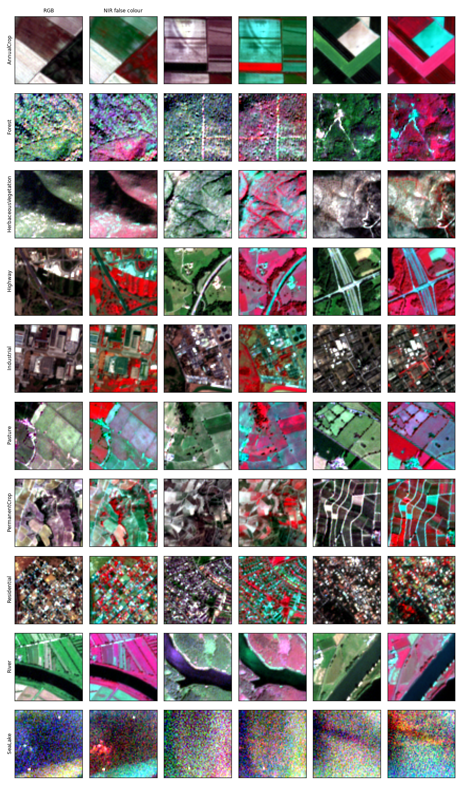
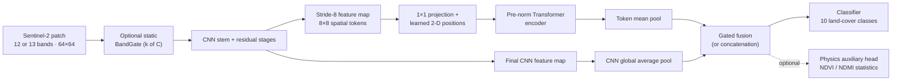
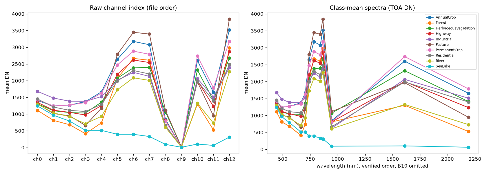

# Spectral-Spatial CNN-Transformer

An experimental PyTorch project for classifying Sentinel-2 satellite patches from EuroSAT. It compares compact multispectral CNN baselines with a CNN-Transformer hybrid and optional learnable spectral-band selection. The implementation and experiment configs are organized under the package name **AgriSpec-XAI**.

<p align="center">
  
</p>
<p align="center"><em>EuroSAT examples rendered as RGB and false-colour multispectral composites.</em></p>

## What this repository contains

- Compact residual CNN and CNN-Transformer classifiers for 64 × 64 patches.
- Optional static sparse gates for selecting a fixed set of Sentinel-2 bands.
- Training and evaluation utilities, model configs, and precomputed split definitions.
- The EuroSAT RGB and multispectral image files.
- Tests for band selection, model export, augmentation, band mapping, and split integrity.

Research PDFs, literature files, personal documents, working master notes, local caches, training checkpoints, and run logs are intentionally not included.

## Model architecture

The main hybrid model keeps the CNN's local spatial features and adds attention over intermediate spatial tokens. A spectral gate can be enabled before the encoder; physics-index and consistency losses are optional training objectives.



### Components

| Component | Implementation |
|---|---|
| **BandGate** | One learnable logit per input band. `topk_st` and `hard_concrete` modes learn a shared, static selection; evaluation uses an exact k-hot mask. The selected first-layer weights can be exported as a genuine k-channel model. |
| **SmallResNet** | A stride-2 convolutional stem followed by four residual stages. The default stage widths are 32, 64, 128, and 256 channels. |
| **Squeeze-and-Excitation** | Optional channel attention inside residual blocks, or an optional input-band SE gate. Input-band weights are per-image and are distinct from the static `BandGate`. |
| **CNNTransformer** | Projects the CNN stride-8 feature map into spatial tokens (8 × 8 = 64 tokens for a 64 × 64 input), adds learned positional embeddings, applies pre-norm Transformer encoder layers, and pools the tokens. |
| **Fusion and head** | Combines pooled Transformer tokens with the final CNN embedding using a learned sigmoid gate (or concatenation), then predicts the class. |
| **Optional training heads/losses** | An auxiliary head predicts NDVI/NDMI summary targets. Training can also add a band-sparsity penalty and consistency loss between radiometric views. All can be disabled through config weights. |

### Included model variants

The YAML files in `configs/runs/` define experiment variants:

- **RGB CNN** — compact residual CNN using visible RGB bands.
- **12-/13-band CNN** — multispectral residual CNN baselines.
- **SE CNN / input-SE CNN** — feature-channel or input-band SE attention.
- **CNN-Transformer** — hybrid spatial-attention encoder with gated feature fusion.
- **Gated variants** — any supported encoder can use `topk_st` or `hard_concrete` spectral selection.
- **RGB ResNet-50 baseline** — the separate `scripts/b1_resnet50_rgb.py` baseline.

## EuroSAT data

Both dataset variants are included:

- `EuroSAT_MS/EuroSAT_MS/` — 27,000 multispectral GeoTIFF patches across 10 classes (13 bands per patch).
- `EuroSAT_RGB/` — 27,000 RGB images across the same 10 classes.

The raw multispectral files occupy approximately 2.7 GB; RGB files occupy approximately 88 MB. The processed NumPy cache is **not** included because it is reproducible and adds another multi-gigabyte copy. The training pipeline's canonical 12-band selection and file-order mapping are defined in `configs/band_map_eurosat.yaml` and `src/agrispec/data/eurosat.py`.

The project also includes random, grouped, and geographic split CSVs under `splits/`. If you redistribute or reuse the dataset, follow the dataset's applicable terms and attribution requirements.

<p align="center">
  
</p>
<p align="center"><em>Measured class-mean spectra and the verified Sentinel-2 band order.</em></p>

## Setup

Python 3.11 or newer is required.

```powershell
python -m venv .venv
.\.venv\Scripts\Activate.ps1
python -m pip install --upgrade pip
python -m pip install -e .
```

## Prepare the multispectral cache

The training loader reads a generated uint16 NumPy cache for efficient access. From the repository root:

```powershell
python scripts/build_eurosat_cache.py
```

This reads the GeoTIFFs in `EuroSAT_MS/EuroSAT_MS/` and writes generated files under `data/processed/`. They are ignored by Git. Split and normalization configs are already provided in this repository.

## Train and test

```powershell
# Quick model/gate smoke test
python scripts/smoke_test.py

# Train the CNN-Transformer configuration
python scripts/train.py configs/runs/b8_cnn_transformer_12band.yaml --set seed=1 train.epochs=5

# Run the full test suite (data-dependent tests require the cache above)
python -m pytest -q
```

Training results and checkpoints are written locally under `results/`; these generated artifacts are excluded from version control.

## Repository layout

```text
assets/                 README figures
configs/                Base, band-map, normalization, and run configurations
EuroSAT_MS/             Raw 13-band GeoTIFF dataset
EuroSAT_RGB/            Raw RGB dataset
scripts/                Cache building, analysis, training, and baseline scripts
splits/                 Random, grouped, and geographic split definitions
src/agrispec/data/      EuroSAT loading, augmentation, and index targets
src/agrispec/models/    Band gate, residual CNN, CNN-Transformer, model factory
src/agrispec/train/     Training and evaluation loop
tests/                  Focused model, data, and split tests
```

## Notes

- Model outputs are experimental and should be evaluated on the intended geographic and class distribution before practical use.
- Generated caches, logs, metrics, and checkpoints are local-only; rerun the documented steps to recreate them.
